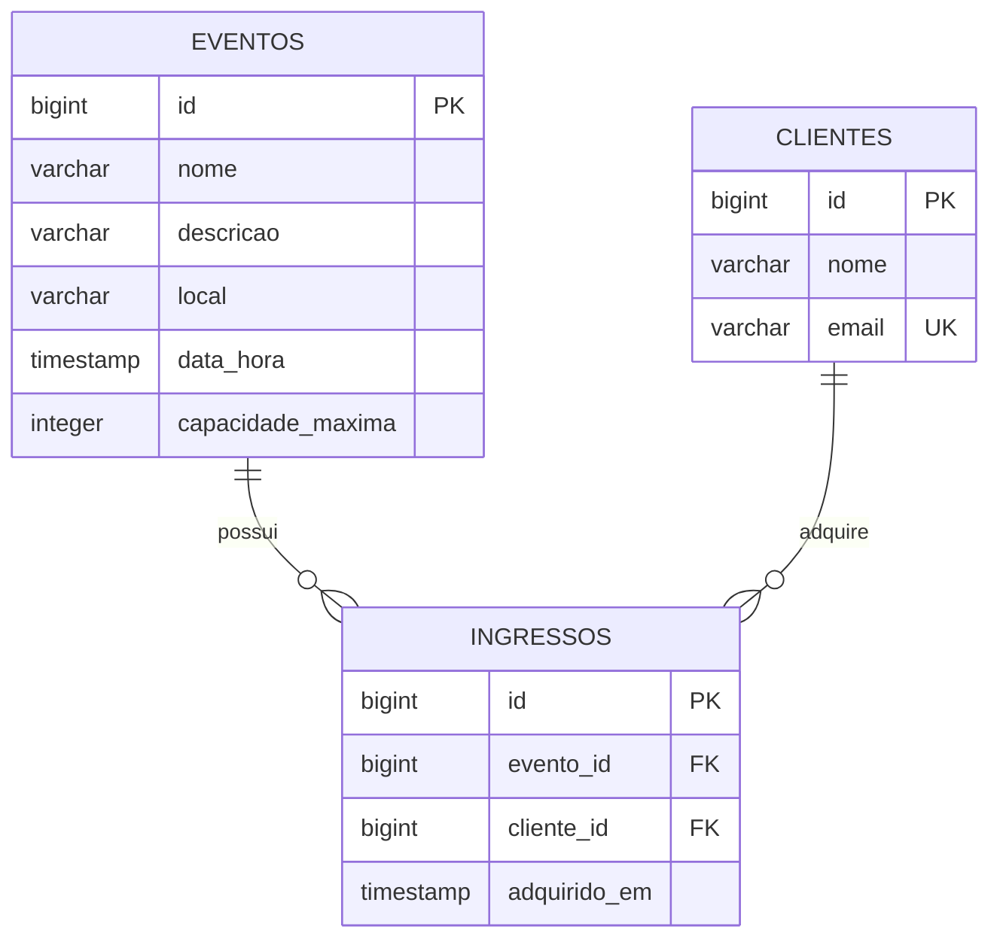

# Modelo de domínio

Três entidades e dois relacionamentos N:1. Cada ingresso representa **uma** aquisição individual.

## Entidades

### Evento

Guarda a programação cultural e a quantidade máxima de ingressos.

| Atributo | Tipo Java | Coluna | Obrigatório | Regra |
|---|---|---|---|---|
| `id` | `Long` | `id` | sim | PK gerada pelo banco |
| `nome` | `String` | `nome` | sim | Até 120 caracteres |
| `descricao` | `String` | `descricao` | sim | Até 1000 caracteres |
| `local` | `String` | `local` | sim | Até 200 caracteres |
| `dataHora` | `LocalDateTime` | `data_hora` | sim | Hora local combinada pelo grupo, JSON ISO-8601 |
| `capacidadeMaxima` | `Integer` | `capacidade_maxima` | sim | Pelo menos 1 |

### Cliente

Identifica o comprador sem implementar autenticação.

| Atributo | Tipo Java | Coluna | Obrigatório | Regra |
|---|---|---|---|---|
| `id` | `Long` | `id` | sim | PK gerada pelo banco |
| `nome` | `String` | `nome` | sim | Até 120 caracteres |
| `email` | `String` | `email` | sim | E-mail válido, até 255, único e normalizado em minúsculas |

### Ingresso

Vincula a compra de um ingresso a exatamente um evento e um cliente.

| Atributo | Tipo Java | Coluna | Obrigatório | Regra |
|---|---|---|---|---|
| `id` | `Long` | `id` | sim | PK gerada pelo banco |
| `evento` | `Evento` | `evento_id` | sim | FK para `eventos.id` |
| `cliente` | `Cliente` | `cliente_id` | sim | FK para `clientes.id` |
| `adquiridoEm` | `LocalDateTime` | `adquirido_em` | sim | Definida pelo servidor, não pelo comprador |

`ingressosDisponiveis` é apenas um campo do `EventoResponseDTO`, calculado como `capacidadeMaxima - quantidadeVendida`. Não existe coluna redundante de ingressos vendidos.

## Relacionamentos

| De | Para | Tipo | No banco | No código |
|---|---|---|---|---|
| Ingresso | Evento | muitos para um | `ingressos.evento_id` referencia `eventos(id)` | `@ManyToOne` em `Ingresso` |
| Ingresso | Cliente | muitos para um | `ingressos.cliente_id` referencia `clientes(id)` | `@ManyToOne` em `Ingresso` |

## Diagrama ER

Cada evento e cada cliente têm zero ou mais ingressos. Cada ingresso se refere a um evento e a um cliente existentes. O banco não aceita chaves estrangeiras inexistentes.

## Migrations

As tabelas são criadas exclusivamente pelo Flyway em `src/main/resources/db/migration`. `spring.jpa.hibernate.ddl-auto=validate` impede que o Hibernate crie tabelas.

| Versão | Arquivo | O que cria |
|---|---|---|
| V1 | `V1__criar_eventos.sql` | Tabela `eventos` |
| V2 | `V2__criar_clientes.sql` | Tabela `clientes`, e-mail único |
| V3 | `V3__criar_ingressos.sql` | Tabela `ingressos`, duas FKs e índices |
